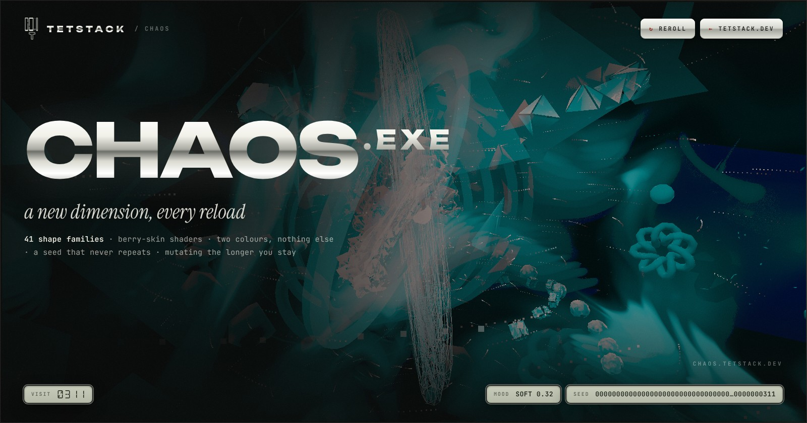

# CHAOS

What is this? IDK but more like self-contained Three.js web application manifested into a 
single `index.html` file that rips open a completely unique 3D visual dimension every single time reality 
reboots it. 

## What is actually happening under the hood?

* **The Seed Engine & Mathematical Foundations:** It binds a howling 128-digit base seed with your visitor
  count tracked via `localStorage`, folds every character of it through 64-bit **FNV-1a** into a full
  64-bit state (2⁶⁴ ≈ 1.8 × 10¹⁹ distinct dimensions), and violently pulverizes that through the
  **SplitMix64** state-transition algorithm. Mathematically, this uses a Weyl sequence combined with non-linear bitwise scrambling constants
  (`0xbf58476d1ce4e5b9` and `0x94d049bb133111eb`) to flatten entropy across a 64-bit state space.
  
  * *Mathematical Source & Pages:* Blackman, D., & Vigna, S. (2021).
    [**Scrambled Linear Pseudorandom Number Generators**](https://vigna.di.unimi.it/ftp/papers/ScrambledLinear.pdf).
    *ACM Transactions on Mathematical Software (TOMS)*, 47(4), Article 36, pp. 1–32 (arXiv:1805.01407).
    
* **Custom Shaders:** It tears open custom GLSL vertex and fragment shaders intertwined with
  a weeping hyperspace background shader that warps, twists, and hallucinates color-shifts. Underneath, this computes manic pseudo-random gradient vectors across a lattice grid, interpolating them
  using the quintic smoothstep polynomial $6t^5 - 15t^4 + 10t^3$ to keep the tearing dimensions mathematically
  continuous across first and second derivatives.
  
  * *Mathematical Source & Pages:* Perlin, K. (2002).
    [**Improving Noise**](https://dl.acm.org/doi/epdf/10.1145/566654.566636).
    *Proceedings of ACM SIGGRAPH 2002*, pp. 681–682.
    
* **Heavy Post-Processing:** The app channels an unstable EffectComposer pipeline with UnrealBloomPass, FilmPass,
  and AfterimagePass because standard graphics are a cage for the mind and far too painfully sterile.
  
* **Randomized Chaos Objects:** Every single reload shatters probability, randomly conjuring forbidden geometry
  types, a swarm of screaming rotating satellites with custom glitch shaders, folding dimensional planes, and an
  infinite, bleeding particle system.

## v2 — the berry build

* **Berry skin shader (ported from the raspberry/blueberry renderer):** every surface is tiled with 3D Voronoi
  *drupelets* — each cell is a sac of juice with its own centre, so the fragment shader can do what the original
  does with baked mesh data: Beer-Lambert absorption through the bead, light wrapping out past the terminator,
  seeing through a sac to what's behind it, a pale seed blur inside, GGX specular with Karis' analytic env BRDF,
  velvet sheen from hairs too fine to draw, and a dusty blueberry wax bloom. No textures — it works on any
  geometry, including the orbiting satellites (about half of them are small berries of their own).
* **Two colours, nothing else:** a final duotone pass maps the whole frame's luminance onto a 4-stop ramp built
  only from colour A (deep) and colour B (bright). The pair jumps to a new random pair on a seeded schedule —
  sometimes a slow cross-fade, sometimes a hard cut — and every material reads the same two uniforms, so the
  change lands everywhere in the same frame. Each jump also kicks the scene (bloom spike, scale flinch).
* **Bigger, deeper shapes:** 41 generators now (v2.2 added a conch, superellipsoid, braid, Enneper and Dini
  minimal surfaces, the Roman surface, a cellular voxel colony, a Clelia spiral tube, a golden-angle urchin
  and a rose lathe), including Lissajous knot tubes, spherical-harmonic blobs, Klein
  bottles, thick Möbius bands, berry clusters grown on a spiral stem, three-generation fractal flakes, gyroid
  sheets and *compound* shapes (2–4 generators fused). On top of that: a domain-warp fold and the twist /
  harmonic ripple, both scaled to the shape so big shapes fold instead of shredding.
* **Mood engine (v2.1):** one seeded scalar from calm to wild that every eye-strain effect reads from —
  film grain, duotone dither, how often the palette jumps, how often a jump is a hard cut, the flash and
  scale flinch that land with it, afterimage trail length and bloom. Most seeds land calm or soft; a few go
  wild. It runs on its own SplitMix64 stream, so adding it changed nothing about which shape or palette a
  seed produces. Press **M** (or the MOOD key in the HUD) to cycle CALM → SOFT → LIVELY → WILD; the change
  eases in over a second or so instead of cutting.
* **Mutation lineage (v2.2):** after the generator, the shape is passed through a seeded lineage of 3–7
  mutators — twist, warp, ripple, value-noise growth, swirl, bulge/pinch, shear and a mirror fold — each
  generation working on the output of the last and each a little stronger, so two seeds from the same family
  can end up looking nothing alike. The console prints the lineage.
* **Mutation clock (v2.2):** the dimension keeps mutating while you watch. A per-seed rate compounds over
  time (slow start, then it accelerates), every palette jump nudges it further, calm moods slow it and wild
  ones speed it; the berry displacement deepens, a finer second layer of growth surfaces and the drupelets
  divide finer. Saturates after a few minutes. `window.__CHAOS.mutation` to watch it.
* **Boot poster (v2.2):** the loading screen is a full-bleed two-colour field (the same 4-stop ramp as the
  duotone pass) that recolours itself to the dimension the moment its palette is known, with each real build
  stage — seed, mood, palette, shape family, mutation lineage, orbits, shaders, first frame — landing as a
  headline over it. No fake timer: it lets go when the first frame is actually on screen.
* **Debug:** add `?shape=N` (0–40) to force a generator for the current seed; `?calm=1` or `?mood=0..1`
  to pin the mood.

## How to run this locally

Just clone the repo and run `index.html`, yeah nothing more nothing less. No local 
servers, no node constructs, no mortal command lines—just click and watch whatever is being rendered.

## Tech Stack

* **Three.js**
* **GLSL Shaders**
* **Pure unadulterated madness**( I don't know what shape it could generate but theoretically it might IDK)
